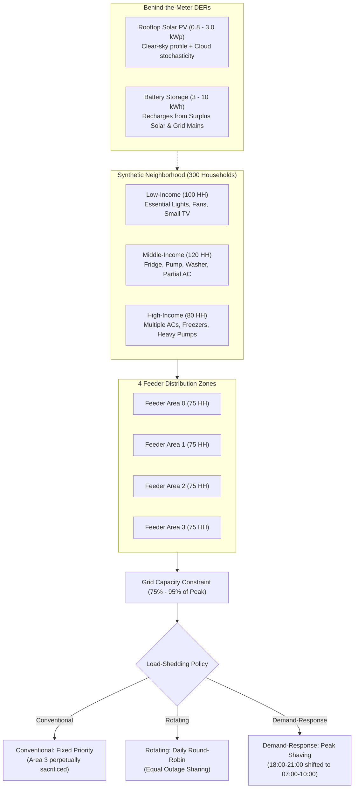

# GridBalance: Simulation of Household Electricity Demand and Load-Shedding Under Limited and Unreliable Supply

[](https://colab.research.google.com/github/)
[](https://www.python.org/)
[](LICENSE)
[](#scientific-model-validation-suite)

A high-fidelity agent-based stochastic simulation modeling electricity demand, feeder-level load-shedding policies, rooftop solar PV adoption, and battery energy storage across socioeconomically stratified urban households under constrained and unreliable grid supply.

---

## 📌 Table of Contents
1. [Overview](#-overview)
2. [Problem Statement](#-problem-statement)
3. [Key Features & Computational Architecture](#-key-features--computational-architecture)
4. [Order of Calculation (7-Step Hourly Cycle)](#-order-of-calculation-7-step-hourly-cycle)
5. [Load-Shedding Policies Evaluated](#-load-shedding-policies-evaluated)
6. [Key Empirical Findings & Statistical Results](#-key-empirical-findings--statistical-results)
7. [Scientific Model Validation Suite](#-scientific-model-validation-suite)
8. [How to Run](#-how-to-run)
    - [Option 1: Google Colab (One-Click)](#option-1-google-colab-recommended)
    - [Option 2: Local Jupyter Notebook](#option-2-local-jupyter-notebook)
9. [Repository Structure](#-repository-structure)
10. [Assumptions & Disclaimer](#-assumptions--disclaimer)
11. [License](#-license)

---

## 📖 Overview

In developing power distribution systems such as Bangladesh, peak electricity demand frequently exceeds available generation and transmission capacity. To prevent grid-wide blackouts, utilities resort to **load-shedding**—disconnecting feeder lines to forcibly shed load. 

**GridBalance** simulates an urban neighborhood of **300 households** divided across **4 distribution feeder areas** over a multi-week horizon (**28 days**, representing 7 complete 4-feeder rotation cycles). It investigates how different operational strategies (conventional fixed shedding vs. round-robin rotational shedding vs. demand-response load shifting), combined with distributed rooftop solar PV and battery storage (BESS / IPS inverters), affect unserved energy, fairness, and consumer electricity expenditures.

---

## 🎯 Problem Statement

> *How can households and distribution utilities manage electricity when grid supply is limited or unreliable, and which operational strategies reduce unserved demand and outage hours fairly and cost-effectively across income tiers?*

---

## ⚙️ Key Features & Computational Architecture



- **Socioeconomic Stratification**: Households are grouped into Low (33.3%), Middle (40.0%), and High (26.7%) income tiers with realistic appliance portfolios (lights, fans, refrigerator, water pump, washing machine, TV, and air conditioners) having priority tags (`essential` vs `nonessential`), power ratings, and stochastic usage variation ($\pm 15\%$).
- **Distribution Feeders**: 4 feeder zones (75 households each). Feeders are assigned independently of household income to reflect real-world mixed feeder topologies.
- **Rooftop Solar PV**: Follows a diurnal bell-curve profile peaking at solar noon (12:00) with stochastic cloud-cover events.
- **Dual-Source Battery Storage (BESS / IPS)**: Batteries discharge during grid outages to sustain critical demand and recharge from **both** surplus solar and grid power during normal supply.
- **BERC Stepped Tariffs**: Incorporates the official Bangladesh Energy Regulatory Commission stepped domestic tariff structure starting with the $0\text{--}50\text{ kWh}$ lifeline slab ($4.35\text{ BDT/kWh}$) up to $>600\text{ kWh}$ ($13.26\text{ BDT/kWh}$) plus fixed meter charges.

---

## 🔄 Order of Calculation (7-Step Hourly Cycle)

For every hour of each day, the simulation follows a strict physical sequence:
1. **Need (Demand Generation)**: Base load is computed from active appliances with stochastic variations.
2. **Shift (Demand-Response)**: If active, flexible loads (pump, washer, part of AC) shift from the evening peak ($18:00\text{--}21:00$) to morning ($07:00\text{--}10:00$). Daily total energy remains conserved.
3. **Minus Solar**: Solar generation covers the household's own demand first; surplus solar charges the battery.
4. **Grid Check**: The grid operator compares neighborhood net demand against available capacity ($75\%\text{--}95\%$ of unconstrained peak).
5. **Decide Cut (Load-Shedding)**: If demand exceeds capacity (or an unplanned blackout occurs), feeders are disconnected according to policy.
6. **Battery Covers Cut**: In disconnected areas, batteries discharge down to their minimum state-of-charge ($20\%$ reserve) to serve deficit.
7. **Record**: Energy served, unserved energy, outage hours, battery state-of-charge, and BERC tariffs are logged.

---

## ⚖️ Load-Shedding Policies Evaluated

1. **Conventional**: Distribution feeders are cut based on a fixed hierarchical order (e.g., Area 3 is repeatedly disconnected whenever a supply shortfall occurs).
2. **Rotating (Round-Robin)**: The disconnection order rotates daily across the 4 feeder areas over a 28-day schedule ($7 \times 4$ full cycles), guaranteeing mathematical fairness in outage exposure.
3. **Demand-Response (DR)**: Participating households ($0\%\text{--}100\%$, baseline $60\%$) shift flexible non-essential loads out of the evening peak into morning valley hours.

---

## 📊 Key Empirical Findings & Statistical Results

| Metric | Conventional | Rotating | Demand-Response (60%) | Statistical Test |
| :--- | :---: | :---: | :---: | :--- |
| **Total Unserved Energy** (28 days) | $14,233.2 \pm 938.1$ kWh | $14,763.2 \pm 602.1$ kWh | $14,455.3 \pm 593.3$ kWh | Paired $t$-test (Rot vs DR): $t = 14.03, p = 1.76 \times 10^{-11}$ |
| **Effective Outage Hours** | $1.45 \pm 0.08$ h/day | $1.45 \pm 0.08$ h/day | $1.45 \pm 0.09$ h/day | ANOVA across policies: $F = 0.58, p = 0.5611$ (not significant at 0.05) |
| **Jain's Fairness Index** $[0, 1]$ | $0.9793$ | $0.9997$ | $0.9997$ | Paired $t$-test: $t = 87.39, p = 3.22 \times 10^{-26}$ |
| **Unit Electricity Cost** | $9.50$ BDT/kWh | $9.47$ BDT/kWh | $9.47$ BDT/kWh | Stable across policies |

### Summary of Insights:
1. **Rotational Fairness**: Rotating load-shedding drastically eliminates geographical discrimination (raising Jain's index from $0.9793$ to $0.9997$, $p < 10^{-25}$). Under Conventional shedding, Feeder Area 3 suffers perpetual outages while Area 0 experiences almost none.
2. **Demand-Response: Modest Benefit Scaling with Participation**:
   - Shifting flexible loads yields a modest **$2.1\%$ reduction** in unserved energy at $60\%$ participation, scaling to **$14.2\%$ reduction** at $100\%$ participation.
   - Baseline evening shiftable loads represent **$17.81\%$** of total evening peak consumption ($241.9\text{ kWh} / 1358.0\text{ kWh}$).
3. **Socioeconomic Equity**:
   - Outage hours are virtually identical across income groups ($\sim 1.16\text{--}1.31\text{ h/day}$) because feeder lines are assigned independently of income.
   - In absolute kWh, High-income households lose more energy ($116.32\text{ kWh}$ vs. $6.23\text{ kWh}$ for Low) due to heavy air-conditioning loads.
   - Low-income households own fewer solar and battery systems ($7\%$ solar, $0\%$ battery for Low vs. $28.7\%$ solar for High by model assumption), limiting their independent outage-mitigation capability.

---

## 🧪 Scientific Model Validation Suite

The simulation includes an automated test suite enforcing 4 fundamental physical and invariance properties. All 4 checks execute and pass automatically:

```text
================================================================================
SCIENTIFIC MODEL VALIDATION CHECKS
================================================================================
[PASSED] Supply Monotonicity:   75% (19,528.6 kWh) > 85% (14,763.2 kWh) > 95% (9,238.9 kWh)
[PASSED] Battery Monotonicity:  0k (1.45 h) >= 3k (0.98 h) >= 5k (0.97 h) >= 10k (0.96 h/day)
[PASSED] Solar Cost Reduction:  0% (1,297,002 BDT) > 20% (1,190,632 BDT) > 50% (1,033,785 BDT)
[PASSED] Zero-Shift Invariance: Rotating == DR (0% participation) for seeds 42..46 (max diff: 0.00e+00 kWh)
================================================================================
```

---

## 🚀 How to Run

### Option 1: Google Colab (Recommended)
1. Click the **Open In Colab** badge at the top of this README (or open [Google Colab](https://colab.research.google.com/) and paste your repository link).
2. Run the notebook directly by selecting **Runtime** $\rightarrow$ **Run all** (`Ctrl + F9`).
3. No external file downloads are required; the notebook is fully self-contained!

### Option 2: Local Jupyter Notebook
Clone the repository and run:
```bash
# Clone the repository
git clone https://github.com/<YOUR_USERNAME>/<REPO_NAME>.git
cd <REPO_NAME>

# Create and activate a virtual environment
python3 -m venv .venv
source .venv/bin/activate  # On Windows: .venv\Scripts\activate

# Install required packages
pip install -r requirements.txt

# Launch JupyterLab / Notebook
jupyter lab GridBalance_Simulation.ipynb
```

---

## 📁 Repository Structure

```text
.
├── GridBalance_Simulation_Annotated.ipynb # Guided walkthrough notebook with detailed explanations before every section
├── GridBalance_Simulation.ipynb           # Standalone, fully executed Jupyter Notebook with embedded plots & outputs
├── requirements.txt                       # Minimal Python dependencies (numpy, pandas, matplotlib, seaborn, scipy)
├── README.md                              # Comprehensive project documentation
├── LICENSE                                # MIT Open-Source License
└── .gitignore                             # Standard Python/Jupyter gitignore
```

---

## ⚠️ Assumptions & Disclaimer

- **Empirical Calibration**: Tariffs and appliance profiles are assumed values; they must be verified against the latest BERC tariff order and BPDB reports before final regulatory submission.
- **Power System Physics**: This is an energy-balance simulation focusing on hourly active power (kW/kWh). Distribution line impedance, reactive power flows, and busbar voltage stability are outside the scope of this model.

---

## 📄 License

This project is licensed under the MIT License - see the [LICENSE](LICENSE) file for details.
